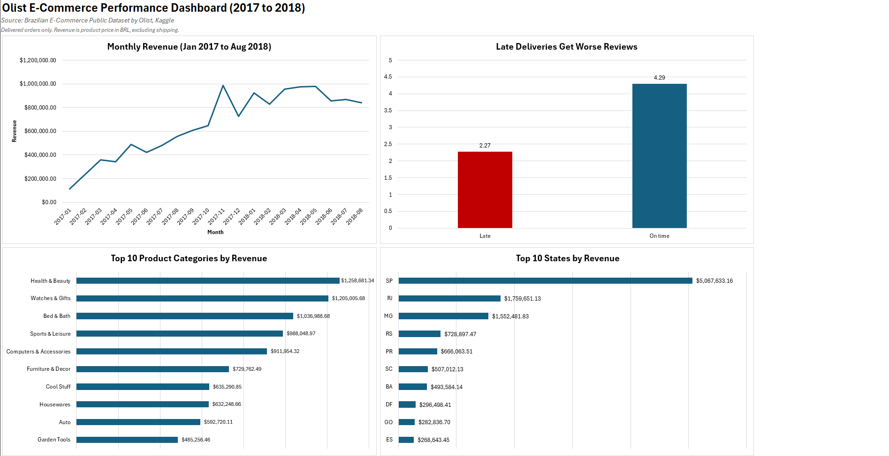

# Olist E-Commerce Analysis (2017–2018)

**Tools:** SQL (SQLite / DB Browser), Excel (charts, dashboard)

## Problem
What drives revenue for Olist, a Brazilian online marketplace, and what is hurting customer satisfaction?

## Data
Brazilian E-Commerce Public Dataset by Olist: ~100,000 orders (2016–2018) across 8 related tables.
I joined orders, order items, products, customers, reviews and category translations.

## Method
- Imported the CSVs into SQLite and explored each table and its keys
- Wrote 4 SQL queries using CTEs and joins to answer one business question each
- Filtered to delivered orders; revenue = product price in Brazilian reais (R$), excluding shipping
- Exported results to Excel and built a one-page dashboard

## Key findings
1. **Late deliveries hurt reviews:** late orders average 2.27 stars vs 4.29 for on-time orders, though only 6.7% of orders were late.
2. **Revenue grew fast:** Jan–Jul 2018 revenue was about 2.6x the same period in 2017.
3. **November is the peak:** revenue jumped 52% from Oct to Nov 2017, likely due to Black Friday.
4. **Sales are concentrated:** São Paulo brings in 38% of revenue; the top 3 states (SP, RJ, MG) bring in 63%.
5. **A few categories lead:** Health & Beauty, Watches & Gifts and Bed & Bath each brought in over R$1M.

## Recommendations
1. **Fix delivery reliability first:** review late orders by seller and region, and set more realistic delivery estimates.
2. **Prepare for November:** plan stock, staff and shipping ahead of Black Friday so peak sales don't bring more late orders.
3. **Grow beyond São Paulo:** test marketing or faster shipping in smaller states to reduce reliance on SP.

## Limitations
- 2016 and late 2018 contain partial data; those months are excluded or flagged.
- Growth compares Jan–Jul only, because August 2018 is incomplete (orders not yet delivered when the data ends).
- Revenue excludes shipping fees.
- Findings show associations, not proven causes.

## Files
- `olist-ecommerce-analysis.xlsx` – dashboard (Overview), Insights and query results
- `queries.sql` – the 4 SQL queries used
- `images/dashboard.png` – dashboard screenshot

## Data source
[Brazilian E-Commerce Public Dataset by Olist](https://www.kaggle.com/datasets/olistbr/brazilian-ecommerce) (Kaggle)
